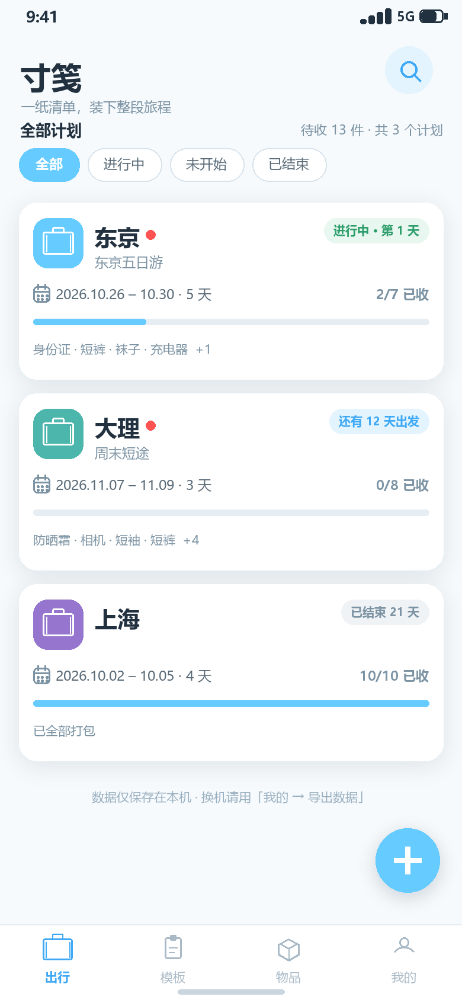
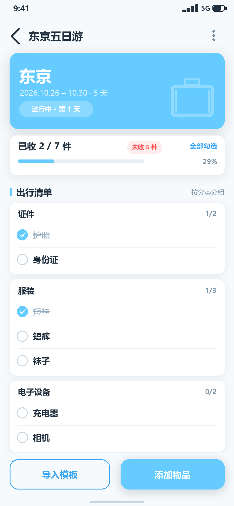
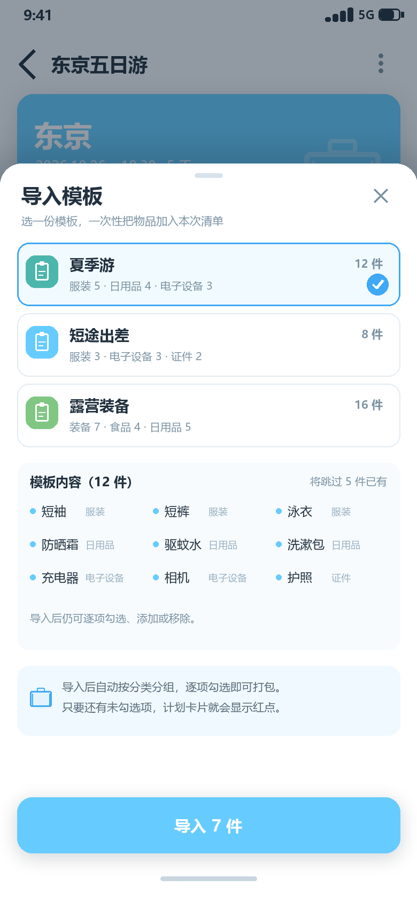
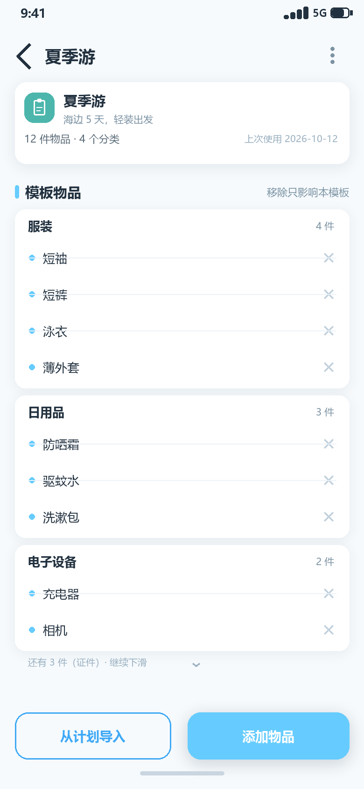
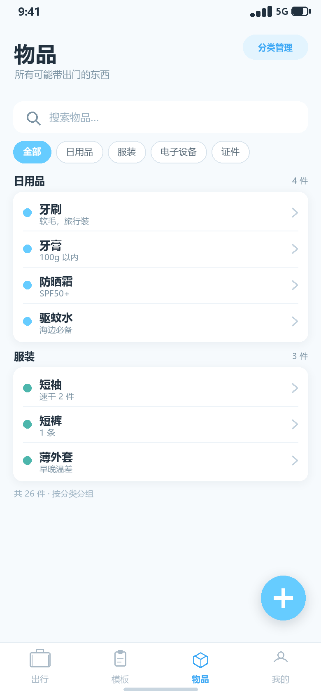

# 寸笺（Field Notes）

> 一纸清单，装下整段旅程 —— Android 出行清单应用（已实现，含设计文档）

「寸笺」是一款**纯本地**的 Android 出行清单应用：维护物品与分类，把常带的东西存成清单模板；出发前建一份计划，直接挑物品或一键导入模板，边打包边勾选。勾选后的物品名称加中划线并变灰；只要清单里还有没勾的，计划卡片就会亮起红点。

界面与工程选型参考同目录下的 [`EndFieldTime`](../EndFieldTime)：半平面风、主色 `#66CCFF`、大圆角卡片、轻投影；技术栈同样落在 Kotlin + Jetpack Compose (Material 3) + Room + DataStore + Flow。数据只存本机，不申请网络权限。




## 功能概览

| # | 需求 | 落地方式 |
| --- | --- | --- |
| 1 | 维护物品 | 「物品」页按分类分组展示，支持搜索、新增、编辑、删除；物品含名称、分类、备注 |
| 2 | 维护物品分类 | 「分类管理」页新增 / 改名 / 换色 / 删除；删除后物品自动归入「未分类」 |
| 3 | 维护清单模板 | 模板含名称、说明、主题色与物品条目；支持新建、改名、复制、删除 |
| 4 | 指定出行计划 | 计划含目的地、可选名称、出行时间（起止日期）、备注、主题色；详情页直接添加物品，或从模板一次性导入 |
| 5 | 模板来源与移除 | 从其他模板导入、从历史出行计划导入；条目可逐项移除（带撤销） |
| 6 | 计划与勾选 | 详情页按分类分组；点击即勾选 / 取消，勾选项名称中划线 + 变灰；顶部进度 `已收 x / y` |
| 7 | 未勾选红点 | 计划条目总数 > 0 且存在未勾选项时，列表卡片显示红点；全部勾选后即时消失 |
| 8 | 全量导出 / 导入 | 分类、物品、模板、计划四类数据一次带走；紧凑 JSON（可选 gzip），支持合并 / 覆盖 |
| 9 | 纯本机运行 | 无登录、无网络权限、无云同步；Room(SQLite) 私有目录存储，卸载即清除 |

## 界面一览

| 计划详情（勾选态 / 红点） | 添加物品（多选） | 导入模板 |
| --- | --- | --- |
|  |  |  |

| 模板列表 | 模板详情 | 物品库 |
| --- | --- | --- |
|  |  |  |

## 设计文档索引

| 文档 | 内容 |
| --- | --- |
| [01 · 界面原型图](docs/01-界面原型图.md) | 导航结构、视觉规范、11 个界面状态与关键组件规格 |
| [02 · 技术选型文档](docs/02-技术选型文档.md) | Compose / Room / Flow / DataStore 选型论证、架构、包结构、依赖与主题 |
| [03 · 功能流程图](docs/03-功能流程图.md) | 启动加载、六类操作、计划详情子流程、红点与状态规则 |
| [04 · 时序图](docs/04-时序图.md) | ①启动与勾选 ②新建计划与导入模板 ③全量导出与导入恢复 |
| [05 · 功能设计文档](docs/05-功能设计文档.md) | 需求列表、数据模型、业务规则、界面行为、关键流程伪代码、异常处理 |
| [06 · 开发与构建说明](docs/06-开发与构建说明.md) | 构建环境、工程结构、实施顺序、测试计划、验收口径 |
| [07 · 数据导入导出设计](docs/07-数据导入导出设计.md) | 格式 v1 规范、体积实测、引用重建、冲突策略、安全边界 |
| [08 · 需求对照与验收清单](docs/08-需求对照与验收清单.md) | 9 条需求 → 设计章节 → 验收用例，逐项可勾选 |
| [09 · 测试效率优化方案](docs/09-测试效率优化方案.md) | 验收提速：62 条 TC 工程化、布局树断言、场景脚本与度量门禁 |
| [10 · 安全与敏感信息审计](docs/10-安全与敏感信息审计.md) | 密钥/权限/组件暴露/导入边界/残留风险与发布结论 |

## 技术栈

**实际落地**：Kotlin 2.3 · Jetpack Compose (Material 3) · MVVM + 单向数据流 · Room + KSP · DataStore · Coroutines/Flow · Navigation Compose · 手动 DI

| 项 | 取值 | 说明 |
| --- | --- | --- |
| 包名 | `com.fieldnotes` | namespace 与 applicationId 一致 |
| minSdk / targetSdk / compileSdk | 26 / 36 / 36 | `java.time` 原生可用，覆盖 API 26+ |
| 构建 | AGP 9.4.1 + Gradle 9.8.2 + KSP 2.3.12 | 与参考项目一致，Kotlin 由 AGP 内置 |
| UI | Compose BOM 2025.12.01 + Material 3 | 声明式 UI，半平面风实现成本最低 |
| 数据 | Room 2.8.2 + DataStore 1.1.7 | 六张表 + 轻量偏好 |
| 导航 | Navigation Compose 2.9.3 | 单 Activity，四个底部页签 |
| 迁移 | `org.json` + `GZIPOutputStream` | 无第三方序列化依赖，格式可控 |
| 测试 | JUnit4 + Compose UI Test + 场景脚本 | 16 条 JVM 单测、6 条 instrumented、30 条布局树断言 |

> 设计文档中标注「参考项目」的内容指 `EndFieldTime` 的已验证实践；「寸笺」现已完成编码、编译、模拟器验收并产出签名 release APK。

## 信息架构

```
寸笺
├── 出行（计划列表）
│   ├── 新建 / 编辑计划
│   ├── 计划详情
│   │   ├── 勾选 / 取消勾选
│   │   ├── 添加物品（多选）
│   │   ├── 导入模板
│   │   ├── 存为模板 / 编辑 / 删除
│   │   └── 左滑移除条目（撤销）
│   └── 状态筛选：全部 / 进行中 / 未开始 / 已结束
├── 模板
│   ├── 新建 / 改名 / 复制 / 删除模板
│   └── 模板详情
│       ├── 从模板导入
│       ├── 从历史计划导入
│       ├── 添加物品 / 移除条目
│       └── 从计划导入
├── 物品
│   ├── 搜索 / 分类筛选 / 增删改
│   └── 分类管理（新增 / 改名 / 换色 / 删除）
└── 我的
    ├── 导出数据（JSON / gzip）
    ├── 导入数据（合并 / 覆盖）
    ├── 清空所有数据
    └── 关于 / 隐私说明
```

## 目录结构

```
FieldNotes/
├── README.md
├── android/                             # ★ Android 工程（可编译、可安装）
│   ├── gradlew / gradlew.bat / gradle/  # Gradle Wrapper 9.8.2 + Version Catalog
│   ├── keystore.properties              # 本地 release 签名配置（不入库）
│   ├── keystore/fieldnotes.jks          # 本地签名密钥（不入库）
│   └── app/src/
│       ├── main/java/com/fieldnotes/    # 应用源码（data / domain / ui / di）
│       ├── test/java/                   # JVM 单测
│       └── androidTest/java/            # Compose UI Test（in-memory Room）
├── docs/
│   ├── 01-界面原型图.md
│   ├── 02-技术选型文档.md
│   ├── 03-功能流程图.md
│   ├── 04-时序图.md
│   ├── 05-功能设计文档.md
│   ├── 06-开发与构建说明.md
│   ├── 07-数据导入导出设计.md
│   ├── 08-需求对照与验收清单.md
│   ├── 09-测试效率优化方案.md
│   ├── samples/export-sample.json      # v1 导出格式样例
│   └── images/                         # 11 张界面原型、图标、流程图、时序图
└── tools/
    ├── gen_prototypes.py               # 生成界面原型图（Pillow）
    ├── gen_diagrams.py                 # 生成流程图与时序图（Pillow）
    ├── measure_export_size.py          # 导出体积实测 + 样例生成
    ├── check_docs.py                   # 校验文档内本地链接与图片引用
    └── ui/                             # 布局树验收场景（见 09）
        ├── ui_harness.py
        ├── run_scenario.py
        └── scenarios/
```

## 当前状态

- [x] 需求梳理与范围界定（9 条需求全部覆盖）
- [x] 界面原型（11 屏）与视觉规范
- [x] 数据模型、业务规则、关键流程伪代码
- [x] 导出格式 v1、体积实测与导入冲突策略
- [x] 验收清单（需求 → 设计 → 用例）
- [x] Android 工程创建与全部功能实现
- [x] 签名 release APK 产出
- [x] 模拟器验收：JVM 单测 16/16、Compose UI Test 6/6、布局树场景 30/30

## 构建与验收

```powershell
$env:JAVA_HOME = 'D:\Program Files\Android\Android Studio\jbr'
cd android

# 编译 / 单测 / UI Test / 签名 release
.\gradlew.bat assembleDebug
.\gradlew.bat testDebugUnitTest
.\gradlew.bat connectedDebugAndroidTest
.\gradlew.bat assembleRelease

# 场景验收（布局树断言，不截图）
$py = "C:\Users\pc\.dsh\dsh-runtimes\dsh-primary-runtime\dependencies\python\python.exe"
& $py ..\tools\ui\run_scenario.py --no-evidence
```

产物：

- `android/app/build/outputs/apk/release/fieldNotes-1.0.apk`（签名，约 9.3 MB）
- `android/app/build/outputs/androidTest-results/connected/debug/TEST-*.xml`
- [`docs/acceptance/report.md`](docs/acceptance/report.md)（30 条场景断言，0 失败，8.7 s）

> release 使用本地 `keystore/fieldnotes.jks` 签名；密钥与配置已加入 `.gitignore`，换机发布请替换为自己的 keystore。

## 重新生成设计图

```powershell
$py = "C:\Users\pc\.dsh\dsh-runtimes\dsh-primary-runtime\dependencies\python\python.exe"
& $py tools/gen_prototypes.py      # 原型图 → docs/images/proto-*.png
& $py tools/gen_diagrams.py        # 流程图 / 时序图 → docs/images/*.png
& $py tools/measure_export_size.py # 体积表 + docs/samples/export-sample.json
& $py tools/check_docs.py          # 校验文档链接与图片引用
```

> 图形脚本依赖 Pillow 与 Windows 自带微软雅黑（`C:/Windows/Fonts/msyh*.ttc`）；仅用于文档出图，不参与 Android 构建。
