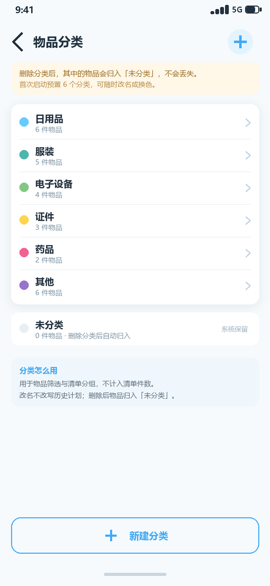
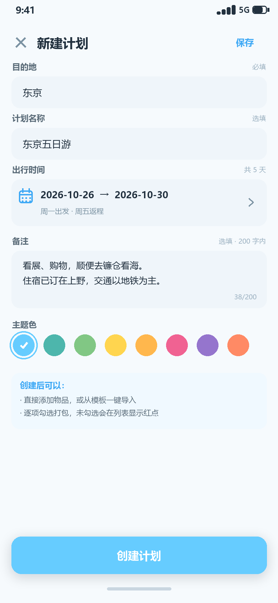
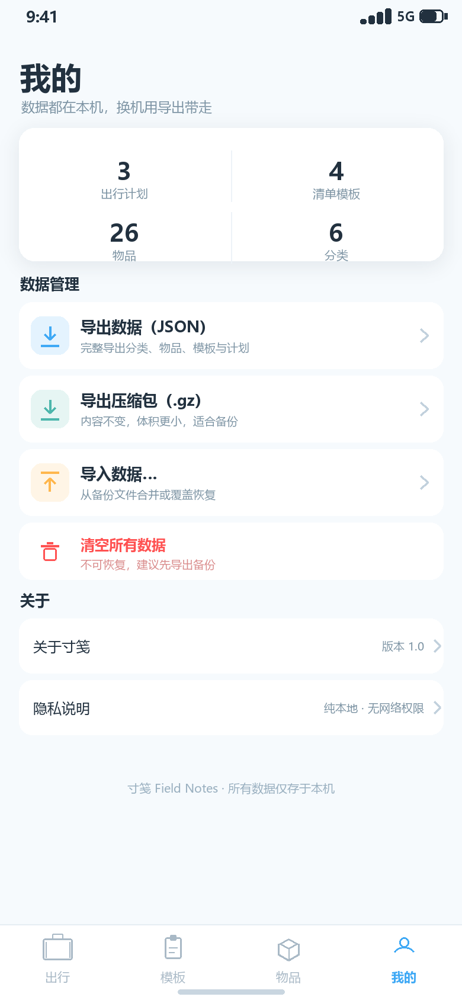
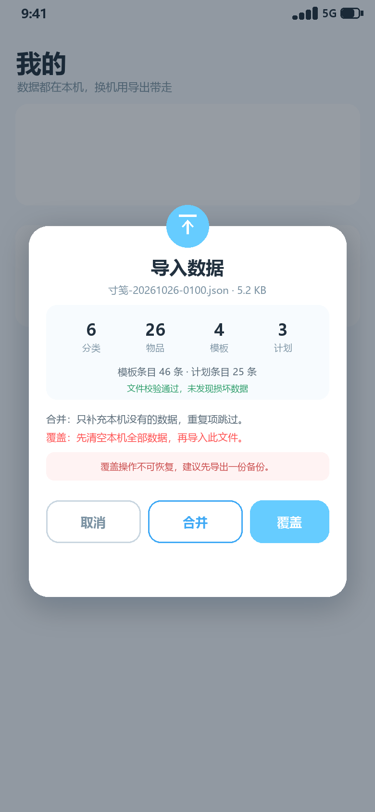

# 寸笺 · 界面原型图

| 项目 | 内容 |
| --- | --- |
| 应用名称 | 寸笺（Field Notes） |
| 设计参考 | `D:\projects\EndFieldTime`（半平面风、主色 `#66CCFF`、大圆角、轻投影） |
| 画布 | 390 × 844 dp（2 倍图 780 × 1688 px） |
| 页面数量 | 11 个界面状态 + 1 个应用图标 |
| 视觉基调 | 清爽、克制、纸张感；蓝色只做强调，不铺满 |
| 适配 | 手机单列为主；≥600dp 双列 / 列表-详情双栏；支持字体放大 |

---

## 1. 设计概念

「寸笺」取“寸许纸笺”之意：一张小纸片，写下要带的东西。英文名 **Field Notes** 延续同一意象。

界面不追求旅行 App 的强场景插画，而是把“清单”本身做成主角：

- **纸感**：页面底色 `#F6FAFD`，内容承载在白色圆角卡片上，轻投影制造“纸片叠放”的层次；
- **蓝色是记号笔**：主色 `#66CCFF` 只用于主按钮、选中态、进度与关键数字，避免整屏泛蓝；
- **勾选是唯一的完成动作**：点一下行即完成，名称加中划线并变灰，不弹确认、不打断；
- **红点只回答一个问题**：“这次出门还有东西没装”。

## 2. 导航结构

```
底部四页签
├── 出行（计划列表）
│   ├── 单击计划卡片 ──→ 计划详情
│   │   ├── 点击清单行 ──→ 勾选 / 取消（中划线 + 变灰）
│   │   ├── 左滑清单行 ──→ 移除 + Snackbar 撤销
│   │   ├── 【添加物品】──→ 物品多选弹层（03）
│   │   ├── 【导入模板】──→ 模板选择弹层（04）
│   │   ├── 更多 ──→ 存为模板 / 全部勾选 / 全部取消 / 编辑 / 删除
│   │   └── 编辑 ──→ 新建·编辑计划页（09）
│   └── ＋ ──→ 新建计划页（09）
├── 模板
│   ├── 单击模板卡片 ──→ 模板详情（06）
│   │   ├── 添加物品 ──→ 物品多选弹层（复用 03）
│   │   ├── 从计划导入 ──→ 历史计划选择弹层
│   │   └── 更多 ──→ 改名 / 从模板导入 / 复制 / 删除
│   └── ＋ ──→ 新建模板对话框
├── 物品
│   ├── 搜索 / 分类筛选
│   ├── 单击物品行 ──→ 编辑物品弹层
│   ├── 分类管理 ──→ 分类管理页（08）
│   └── ＋ ──→ 新建物品弹层
└── 我的
    ├── 导出数据（JSON / gzip）
    ├── 导入数据 ──→ 文件选择 → 导入确认对话框（11）
    ├── 清空所有数据
    └── 关于 / 隐私说明
```

**导航实现**：单 Activity + Navigation Compose。四个页签各自保留返回栈；详情、编辑、分类管理为全屏路由（隐藏底部栏）；物品选择、模板导入、新建物品为 `ModalBottomSheet`（模态覆盖，不占路由）。

## 3. 视觉规范

### 3.1 色彩

| 令牌 | 取值 | 用途 |
| --- | --- | --- |
| `primary` | `#66CCFF` | 主按钮、进度条、选中 Chip、FAB |
| `primaryDeep` | `#3FA9F5` | 图标、装饰、浅色底上的强调 |
| `primaryInk` | `#146C94` | 小字号可点击文字（对比度 ≥ 4.5:1） |
| `primaryContainer` | `#E3F4FE` | 图标底、选中行浅底、提示卡 |
| `background` | `#F6FAFD` | 页面背景 |
| `surface` | `#FFFFFF` | 卡片、弹层、对话框 |
| `field` | `#EFF5FA` | 输入框底 |
| `ink` | `#22313F` | 主文案 |
| `ink2` | `#5A6B78` | 次文案 |
| `ink3` | `#7C93A3` | 辅助说明 |
| `placeholder` | `#9AB0C0` | 占位符 / 已完成条目 |
| `doneText` | `#9AB0C0` | 勾选后的物品名 |
| `danger` | `#FF5252` | 删除、红点、覆盖警告 |
| `success` | `#2E9E6B` | 校验通过、进行中 |
| `line` | `#E5EDF3` | 分隔线 |
| `warningBg` | `#FFF7E8` | 分类删除提示 |

> 原型图按品牌色 #3FA9F5 绘制强调文字；正式实现应把**小字号文字链接**替换为 `primaryInk #146C94`，`#3FA9F5` 仅用于图标与非文本装饰，避免浅蓝在白底上对比度不足。

主题色板（计划 / 模板 / 分类可共用）：

`#66CCFF` `#4DB6AC` `#81C784` `#FFD54F` `#FFB74D` `#F06292` `#9575CD` `#FF8A65`

### 3.2 字体

| 层级 | 字号 / 字重 | 用途 |
| --- | --- | --- |
| Display | 28sp / Bold | 页面标题（寸笺、模板、物品、我的） |
| Headline | 22sp / Bold | 计划目的地、弹层标题 |
| Title | 17sp / Bold | 卡片标题、分组标题 |
| Body | 14sp / Regular | 列表主文案、表单输入 |
| BodySmall | 12sp / Regular | 日期、分类、备注 |
| Caption | 11sp / Regular | 字数、辅助说明 |
| Number | 20sp / Bold | 统计数字、进度数字 |

字体使用系统默认（Android 为 Roboto / 思源黑体），不引入自定义字体，减少包体积。字重只使用 Regular / Medium / Bold 三档。

### 3.3 圆角、间距、投影

| 令牌 | 取值 | 用途 |
| --- | --- | --- |
| 页面边距 | 16dp | 左右安全边距 |
| 卡片圆角 | 15dp | 计划 / 模板 / 分组卡 |
| 弹层顶部圆角 | 20dp | ModalBottomSheet |
| 对话框圆角 | 20dp | 确认框、导入框 |
| 输入框圆角 | 12dp | 表单输入 |
| 按钮圆角 | 16dp（胶囊 28dp） | 主按钮 / Chip |
| 卡片内边距 | 12–16dp | 视内容密度 |
| 卡片间距 | 12dp | 列表 |
| 区块间距 | 20–24dp | 分组之间 |
| 投影 | 2–4dp，低透明度、小 Y 偏移 | 半平面轻投影 |
| 弹层投影 | 8dp | 底部弹层 |

### 3.4 图标

- 基础图标使用 `material-icons-core`（Add、Search、Close、Check、Delete、Edit、MoreVert、ArrowBack、DateRange、Settings 等）；
- 三个业务图标用 `ImageVector` 自绘，避免引入体积较大的 `material-icons-extended`：
  - **行李箱**：出行页签 / 计划卡左侧色块；
  - **清单板**：模板页签 / 模板卡；
  - **收纳箱**：物品页签。
- 图标线宽 2dp，圆角端点；24dp 图标放在 40–44dp 的浅色圆形 / 圆角底上。

## 4. 界面逐屏说明

### 4.1 出行 · 计划列表（01）


| 区域 | 说明 |
| --- | --- |
| 标题栏 | 「寸笺」+ 副标题“一纸清单，装下整段旅程”；右上角搜索按钮（按目的地 / 名称搜索计划） |
| 概览行 | 左侧「全部计划」，右侧“待收 13 件 · 共 3 个计划”；“待收”= 所有计划未勾选条目之和 |
| 状态筛选 | 全部 / 进行中 / 未开始 / 已结束；单选 Chip，选中为主色实心；进入页面默认「全部」 |
| 计划卡片 | 白色圆角卡：左侧主题色行李箱色块；目的地大字 + 可选计划名；右上状态胶囊；日期行；进度条 + `x/y 已收`；底部物品预览 |
| 红点 | 目的地右侧 8dp 红色圆点；条件 = 清单总数 > 0 且存在未勾选项。全部勾选后立即消失 |
| 空状态 | 居中行李箱线稿 + “还没有出行计划，点右下角 ＋ 建一个吧” |
| FAB | 右下角圆形 ＋，主色，点击进入新建计划 |

**状态胶囊**：进行中（绿底绿字，`进行中 · 第 N 天`）、未开始（浅蓝底蓝字，`还有 N 天出发`）、已结束（灰底灰字，`已结束 N 天`）、已完成（绿底绿字，仅清单全部勾选且已结束时可显示）。

**排序**：进行中 → 未开始（出发日近的在前）→ 已结束（结束日近的在前）；同组按 `startEpochDay` 与创建时间兜底。筛选与排序都在 ViewModel 内完成，数据库不做 UI 语义排序。

### 4.2 计划详情（02）


| 区域 | 说明 |
| --- | --- |
| 顶栏 | 返回 + 计划名（为空时显示目的地）+ 右上更多菜单 |
| Hero 卡 | 计划主题色；目的地大字、日期区间 / 天数、状态胶囊；右侧大号行李箱水印 |
| 进度卡 | “已收 2 / 7 件”、红色「未收 5 件」胶囊、右侧「全部勾选」、进度条与百分比 |
| 清单区 | 按分类分组；每组标题 + `已勾/总数`；组内行 = 圆形复选框 + 物品名 |
| 勾选态 | 复选框填充主色 + 白色对勾；名称**中划线**且文字变灰 `#9AB0C0`；行高保持 56dp，不跳动 |
| 未勾选态 | 空心圆描边 `#C9D6E0`；名称主文案色 |
| 底部操作 | 描边【导入模板】+ 主色【添加物品】；固定在底部，列表可滚动 |
| 更多菜单 | 存为模板 / 全部勾选 / 全部取消 / 编辑计划 / 删除计划 |
| 移除条目 | 清单行左滑 → 立即移除 → Snackbar「已移除 短袖 · 撤销」 |
| 空状态 | “清单还是空的” + 两个入口：添加物品 / 导入模板 |
| 红点 | 详情页不重复放红点，用「未收 N 件」红色胶囊表达同一信息 |

> 勾选视觉严格遵循需求 6：**中划线 + 灰色**，两者同时出现；不使用仅变灰或仅打勾的弱表达。

### 4.3 添加物品 · 多选弹层（03）


| 区域 | 说明 |
| --- | --- |
| 弹层 | `ModalBottomSheet`，约 78% 屏高；顶部拖动条、标题、关闭 |
| 搜索 | 输入即过滤物品名 / 备注；不区分大小写 |
| 分类筛选 | 横向滚动 Chip：全部 + 物品分类；与物品库同源 |
| 物品行 | 名称 + 分类；右侧圆形复选框；点击整行切换 |
| 已存在 | 已在当前清单中的物品置灰，右侧显示「已在清单」，不可选 |
| 新建入口 | 搜索词非空时显示「＋ 新建物品『腰包』」，创建后自动选中 |
| 底部按钮 | “添加 3 件”，实时显示已选数量；无选择时禁用 |
| 提交 | 事务内批量插入；按 `nameKey` 去重；关闭弹层并 Toast「已添加 3 件，跳过 1 件已有」 |

### 4.4 导入模板 · 弹层（04）


| 区域 | 说明 |
| --- | --- |
| 标题 | 导入模板 + “选一份模板，一次性把物品加入本次清单” |
| 模板卡 | 模板色块、名称、分类摘要、条目数；单选，选中显示蓝色描边 + 对勾 |
| 内容预览 | 九宫格展示模板前 9 件物品与分类；顶部显示“模板内容（12 件）”与“将跳过 5 件已有” |
| 提示 | “导入后自动按分类分组，逐项勾选即可打包；只要还有未勾选项，计划卡片就会显示红点” |
| 底部按钮 | “导入 7 件” = 模板条目 − 已存在条目；无模板时显示空状态 + 去模板页入口 |

### 4.5 模板列表（05）


| 区域 | 说明 |
| --- | --- |
| 标题栏 | 「模板」+ 副标题“常带的东西，一次收好”；右上搜索 |
| 概览行 | 左侧「全部模板」，右侧“4 个模板 · 46 件物品” |
| 模板卡 | 色块 + 名称 + 说明；右上条目数；分类 Chip 行；底部“上次使用 10-12” |
| 卡片菜单 | 重命名 / 从模板导入 / 复制 / 删除 |
| FAB | 新建模板：弹出对话框输入名称（必填）、说明（选填）、主题色 |
| 排序 | `lastUsedAt` 倒序，其次 `updatedAt` 倒序；最近用过的模板排前面 |

### 4.6 模板详情（06）


| 区域 | 说明 |
| --- | --- |
| 顶栏 | 返回 + 模板名 + 更多菜单 |
| 信息卡 | 名称、说明、条目数 / 分类数、上次使用时间 |
| 物品区 | 按分类分组；行 = 分类色点 + 物品名 + 右侧移除 ✕ |
| 移除 | 点击 ✕ 立即移除；Snackbar「已移除 短袖 · 撤销」，撤销恢复原位置 |
| 底部操作 | 描边【从计划导入】+ 主色【添加物品】 |
| 更多菜单 | 重命名 / 从模板导入 / 复制模板 / 删除模板 |
| 空状态 | “模板还是空的” + 添加物品 / 从计划导入 |

> 模板条目不参与勾选，因此没有复选框；勾选只属于“某一次出行”。

### 4.7 物品库（07）


| 区域 | 说明 |
| --- | --- |
| 标题栏 | 「物品」+ 副标题；右上「分类管理」胶囊按钮 |
| 搜索 | 按名称 / 备注模糊搜索 |
| 分类筛选 | 全部 / 各分类 Chip，横向滚动 |
| 分组列表 | 默认按分类分组；每组标题 + 件数；行 = 分类色点 + 名称 + 备注 + 右箭头 |
| 点击 | 整行进入编辑弹层（名称、分类、备注） |
| 新增 | FAB 打开“新建物品”弹层，可顺手新建分类 |
| 删除 | 编辑弹层内【删除】+ 二次确认；提示“已创建的计划与模板不受影响” |

### 4.8 分类管理（08）



| 区域 | 说明 |
| --- | --- |
| 顶栏 | 返回 + 「物品分类」+ 右上 ＋ |
| 提示卡 | 删除分类后物品归入「未分类」不丢失；首次启动预置 6 个分类 |
| 分类行 | 色点 + 名称 + “N 件物品” + 右箭头；点击进入编辑（改名 / 换色） |
| 未分类 | 系统保留行；不可改名 / 删除；显示数量 |
| 新建 | 右上 ＋ 或底部【新建分类】；名称 1–12 字，同名拦截 |
| 删除 | 二次确认：“该分类下有 N 件物品，删除后归入未分类”；确认后 `categoryId = NULL` |
| 排序 | 手动排序 P1；v1 按 `sortOrder`（预置顺序）+ 创建时间 |

### 4.9 新建 / 编辑计划（09）



| 字段 | 控件 | 规则 |
| --- | --- | --- |
| 目的地 | 单行输入 | 必填，1–40 字；去除首尾空白 |
| 计划名称 | 单行输入 | 选填，≤30 字；为空时列表与详情用目的地作标题 |
| 出行时间 | 日期区间选择（DateRangePicker） | 必填；返程 ≥ 出发；单日行程允许；显示“共 N 天” |
| 备注 | 多行输入 | 选填，≤200 字，右下角字数统计 |
| 主题色 | 8 色圆形色板 | 默认 `#66CCFF`；选中外圈 + 白色对勾 |
| 创建提示 | 浅蓝信息卡 | 创建后可添加物品 / 导入模板 / 逐项勾选 |
| 底部按钮 | 主色通栏 | 新建=「创建计划」；编辑=「保存修改」 |

**编辑模式**：进入时回填全部字段；保存走 `UPDATE`，返回详情并 Toast「已保存」。日期区间本身可缩短到早于已勾选条目的创建时间——条目不受影响。

### 4.10 我的 · 数据（10）



| 区域 | 说明 |
| --- | --- |
| 标题栏 | 「我的」+ “数据都在本机，换机用导出带走” |
| 统计卡 | 计划 / 模板 / 物品 / 分类四个数字，2×2 布局 |
| 数据管理 | 导出数据（JSON）、导出压缩包（.gz）、导入数据…；每行含图标、标题、说明、右箭头 |
| 危险操作 | 清空所有数据（红色）+ “不可恢复，建议先导出备份” |
| 关于 | 关于寸笺（版本 1.0）、隐私说明（纯本地 · 无网络权限） |
| 页脚 | “寸笺 Field Notes · 所有数据仅存于本机” |

### 4.11 导入确认对话框（11）



| 区域 | 说明 |
| --- | --- |
| 标题 | 导入数据；显示文件名与体积（示例 5.2 KB） |
| 统计 | 分类 6 / 物品 26 / 模板 4 / 计划 3；模板条目 46 条 · 计划条目 25 条 |
| 校验 | “文件校验通过，未发现损坏数据”（绿色） |
| 说明 | 合并：只补本机没有的，重复跳过；覆盖：清空后导入（红色） |
| 警告 | “覆盖操作不可恢复，建议先导出一份备份” |
| 按钮 | 取消 / 合并（描边）/ 覆盖（主色实心） |

> 覆盖按钮在视觉上不使用危险红：它是主操作但非删除；红色仅用于警告条，避免与“清空数据”混淆。确认覆盖后仍会再弹一次二次确认。

## 5. 关键组件规格

### 5.1 计划卡片

```
┌─────────────────────────────────────────────┐
│ [色块]  东京  ●                进行中 · 第 1 天 │
│         东京五日游                            │
│  📅 2026.10.26 – 10.30 · 5 天     2/7 已收   │
│  ▓▓▓▓▓░░░░░░░░░░░░░░░░░░░░░░░░░░░░░░░░░░░░  │
│  身份证 · 短裤 · 袜子 · 充电器  +1          │
└─────────────────────────────────────────────┘
```

- 高度 149dp（内容自适应，最低 144dp）；
- 色块 42dp 圆角 12dp；目的地 19sp Bold；计划名 12sp `ink2`；
- 状态胶囊 10sp Bold，内边距 8×21dp；
- 进度条 4dp，圆角，轨道 `#E6EEF4`；
- 底部预览显示前 4 个**未勾选**物品名，超出显示 `+N`；无未勾选项时显示「已全部打包」；
- 红点 8dp，位于目的地右侧 9dp；同时提供 `contentDescription`。

### 5.2 勾选行

| 状态 | 复选框 | 文字 | 触摸 |
| --- | --- | --- | --- |
| 未勾选 | 20dp 空心圆，描边 1.5dp `#C9D6E0` | 14sp Medium `ink` | 整行 56dp 可点 |
| 勾选 | 20dp 主色实心 + 白色对勾 | 14sp Regular `#9AB0C0` + `TextDecoration.LineThrough` | 整行可点；可访问性状态 `checked` |
| 按下 | 行底色 `#F2FAFF` | 不变 | 涟漪 |

实现要点：

```kotlin
Text(
    text = item.name,
    color = if (item.checked) DoneText else Ink,
    textDecoration = if (item.checked) TextDecoration.LineThrough else null,
    maxLines = 2,
    overflow = TextOverflow.Ellipsis
)
```

### 5.3 红点

- 尺寸 8dp，颜色 `#FF5252`，无描边；
- 位置：计划卡片目的地右侧；不以角标覆盖状态胶囊；
- 计算：`total > 0 && checked < total`；
- 语义：`contentDescription = "有 ${total - checked} 件物品未勾选"`；
- 红点不是唯一提示：详情页始终有「未收 N 件」文字胶囊，列表卡片有 `x/y 已收`。

### 5.4 底部弹层

- `ModalBottomSheet`，顶部 20dp 圆角，拖动条 32×4dp `#D8E3EC`；
- 最大高度 88%，内容可滚动，底部主按钮固定；
- 关闭方式：下滑、点遮罩、右上 ✕；
- 打开时背景压暗 45%，弹层阴影 8dp；
- 键盘弹出时 `imePadding()`，搜索框与底部按钮不被遮挡。

### 5.5 空状态与提示

| 场景 | 文案 | 行动 |
| --- | --- | --- |
| 无计划 | 还没有出行计划 | ＋ 新建计划 |
| 无模板 | 还没有清单模板，把常带的东西存一份吧 | ＋ 新建模板 |
| 无物品 | 物品库还是空的 | ＋ 新建物品 / 先建分类 |
| 计划清单为空 | 清单还是空的 | 添加物品 / 导入模板 |
| 模板为空 | 模板还是空的 | 添加物品 / 从计划导入 |
| 搜索无结果 | 没有找到「xxx」 | 清除搜索 / 新建物品 |
| 导入文件损坏 | 这不是有效的寸笺导出文件 | 重新选择 |

### 5.6 删除确认

- 对话框 20dp 圆角，红色圆形警示图标压在顶边；
- 标题「删除计划 / 删除模板 / 删除物品 / 删除分类」；
- 正文说明影响范围（如“删除计划会同时删除 12 条清单记录，模板与物品库不受影响”）；
- 【取消】描边 / 【删除】红色实心；
- 删除模板 / 物品 / 分类属于可重建数据，但一律二次确认，避免误触。

## 6. 状态与反馈

| 操作 | 即时反馈 | 持久化 |
| --- | --- | --- |
| 勾选 / 取消 | 复选框、中划线、灰色、进度、红点同步变化 | `plan_item.checked` |
| 添加物品 | 弹层关闭，清单出现新行，进度分母 +N | 事务批量 INSERT |
| 导入模板 | Toast「导入 7 件，跳过 5 件已有」 | 事务批量 INSERT + 更新 `lastUsedAt` |
| 移除条目 | 行消失 + Snackbar 撤销（5 秒） | DELETE；撤销重新 INSERT |
| 保存计划 | 返回详情 + Toast「已保存」 | INSERT / UPDATE |
| 导出 | Toast「已导出 5.2 KB」 | SAF 写文件 |
| 导入 | 对话框 → 进度 → Toast 汇总 | 事务：合并 / 覆盖 |

## 7. 适配与可访问性

### 7.1 尺寸适配

| 宽度 | 布局 |
| --- | --- |
| < 600dp（手机竖屏） | 单列；底部 NavigationBar；详情底部操作双按钮 |
| 600–840dp（折叠屏展开 / 小平板） | 计划与模板列表两列；详情内容最大宽度 720dp 居中 |
| ≥ 840dp（平板横屏） | 列表-详情双栏（左列表 360dp，右详情）；底部栏改为 NavigationRail |
| 横屏手机 | 详情 Hero 与进度卡并排；清单仍单列 |

使用 `WindowSizeClass` 判断断点；不用 `LocalConfiguration.screenWidthDp` 硬编码。折叠屏形态变化时，列表滚动位置、已选筛选、勾选状态均由 ViewModel / `rememberSaveable` 保留。

### 7.2 可访问性

- 所有可点击目标 ≥ 48×48dp；清单行整行可点；
- 复选框使用 `Modifier.toggleable(role = Role.Checkbox)`，读屏播报“短袖，已勾选”；
- 红点提供文字替代（`未收 N 件`），不单独依赖颜色；
- 状态胶囊的绿 / 灰均配文字，不只靠颜色区分；
- 支持系统字体放大至 200%：卡片高度自适应，物品名最多 2 行省略；
- 主文案 `#22313F` 对 `#F6FAFD` 对比度约 12:1；正文不使用 `#66CCFF`；
- 品牌浅蓝上的白色文字在部分小字号场景低于 4.5:1，实现时用对比度工具逐项检查：小字号文字优先用 `primaryInk #146C94`，或加深填充色；
- 动效遵循系统“移除动画”设置；勾选仅做 120ms 颜色 / 删除线过渡，不做弹跳。

### 7.3 深色主题

v1 仅提供浅色主题（与参考项目一致），避免深色下品牌蓝与分类色对比度失控；色板已按语义令牌组织，P2 增加 `darkColorScheme`：

| 令牌 | 深色建议 |
| --- | --- |
| background | `#101820` |
| surface | `#182430` |
| ink | `#E6F1F8` |
| ink2 | `#A9BCCB` |
| primaryContainer | `#17384A` |
| line | `#26384A` |

## 8. 原型图清单

| 文件 | 界面 |
| --- | --- |
| `images/proto-01-plans.png` | 出行 · 计划列表（含红点 / 三状态） |
| `images/proto-02-plan-detail.png` | 计划详情（勾选态 / 进度 / 分组清单） |
| `images/proto-03-item-picker.png` | 添加物品多选弹层 |
| `images/proto-04-template-import.png` | 导入模板弹层 |
| `images/proto-05-templates.png` | 模板列表 |
| `images/proto-06-template-detail.png` | 模板详情（移除条目） |
| `images/proto-07-items.png` | 物品库 |
| `images/proto-08-categories.png` | 分类管理 |
| `images/proto-09-plan-edit.png` | 新建 / 编辑计划 |
| `images/proto-10-settings.png` | 我的 · 数据管理 |
| `images/proto-11-import-dialog.png` | 导入确认对话框 |
| `images/app-icon.png` | 应用图标（512×512） |

> 原型由 `tools/gen_prototypes.py` 生成，坐标与文案可在脚本内调整后重跑；原型仅用于设计评审，不是像素级实现约束。
