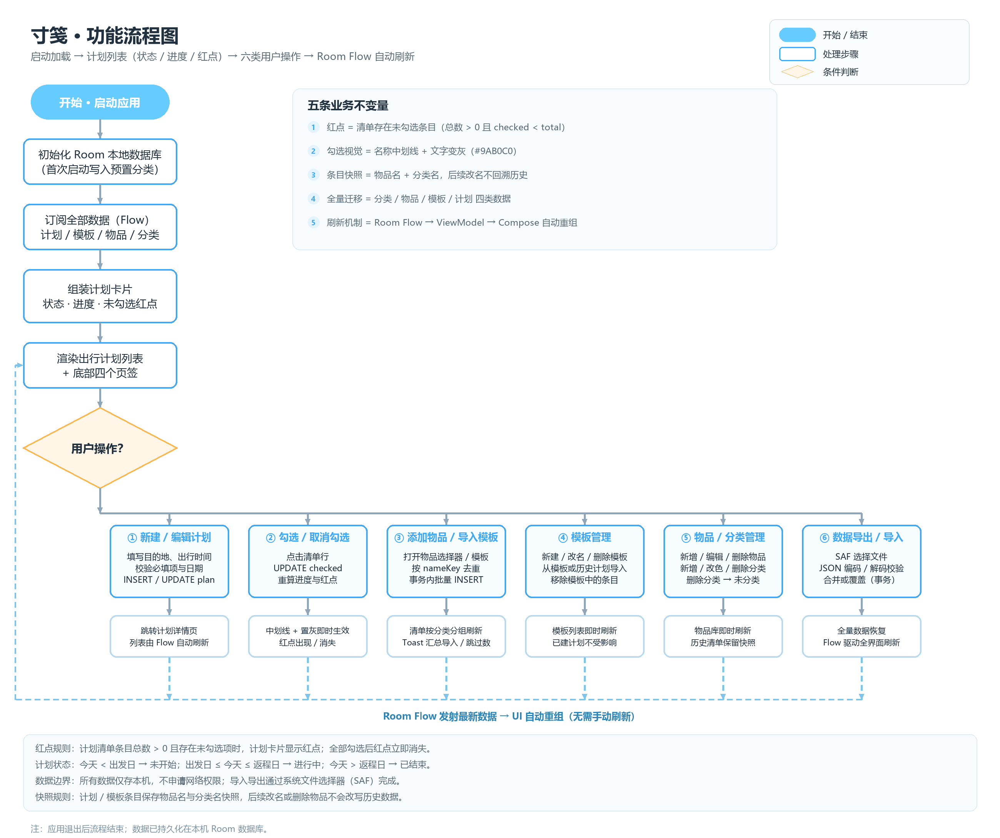
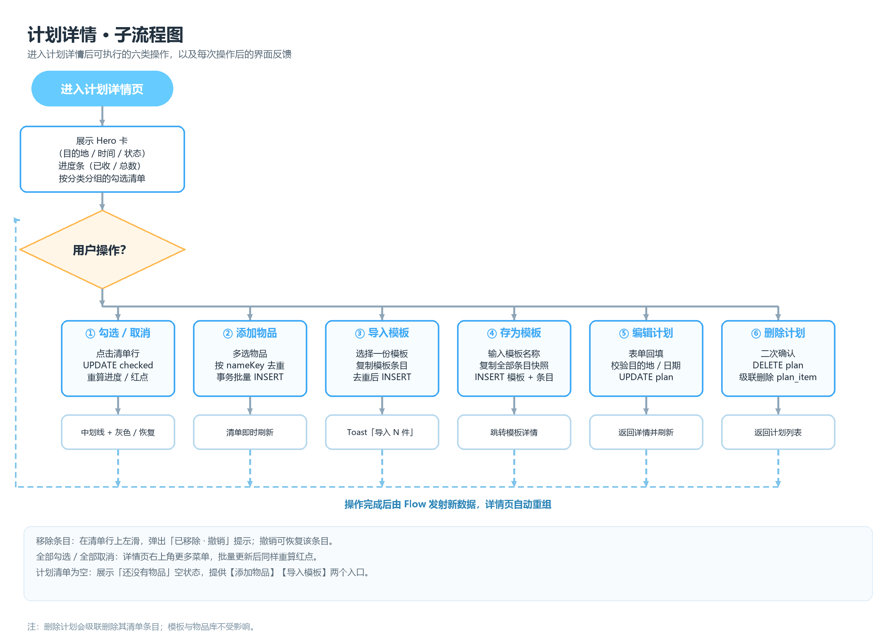

# 寸笺 · 功能流程图



## 1. 主流程说明

| 步骤 | 说明 |
| --- | --- |
| 1. 开始 · 启动应用 | 用户点击桌面图标冷启动 |
| 2. 初始化 Room | 打开 `fieldnotes.db`；首次启动幂等写入 6 个预置分类 |
| 3. 订阅全部数据 | 计划 / 模板 / 物品 / 分类均以 `Flow` 订阅，后续任何写入都会自动推送 |
| 4. 组装计划卡片 | 计算计划状态、`checked/total` 进度、`hasUnchecked` 红点、物品预览 |
| 5. 渲染出行列表 | 顶栏 + 概览 + 状态筛选 + 计划卡片 + 底部四页签 |
| 6. 等待用户操作 | 进入六类操作分支（见下） |
| 7. 数据回流 | 所有写操作落 Room，Flow 发射最新数据，UI 自动重组，回到步骤 5 |
| 8. 退出应用 | 流程结束，数据已持久化在本机 |

## 2. 六类用户操作

### 分支一：新建 / 编辑计划

点击 FAB（或详情页“编辑”）→ 填写目的地、可选名称、出行时间、备注、主题色 → 校验：目的地 1–40 字、返程 ≥ 出发、备注 ≤200 字 → 通过则 `INSERT` / `UPDATE plan` → 新建后跳转详情页（空清单），编辑后返回详情并刷新。

- 校验失败：字段下方行内错误 + 底部 Toast，不写库；
- 日期非法（返程早于出发）：日期区间控件直接拒绝，保存按钮置灰；
- 编辑时影响行数 = 0（记录已被删除）：Toast「计划已不存在」并返回列表。

### 分支二：勾选 / 取消勾选

点击清单行（整行可点）→ `UPDATE plan_item SET checked = ?` → Room 发射新数据 → ViewModel 重算 `checked/total` 与 `hasUnchecked` → UI 即时更新：

- 勾选：复选框填充 + 白色对勾；名称 **`TextDecoration.LineThrough` + `#9AB0C0`**；
- 取消：恢复空心圆与主文案色；
- 红点：全部勾选后消失；取消任一勾选后重新出现；
- 进度条与「已收 x / y 件」「未收 N 件」同步变化。

### 分支三：添加物品 / 导入模板

| 入口 | 流程 |
| --- | --- |
| 添加物品 | 打开物品多选弹层 → 搜索 / 分类筛选 → 勾选多个 → 确认 → 事务批量 `INSERT plan_item`（快照名称 + 分类名） |
| 导入模板 | 打开模板选择弹层 → 单选模板 → 预览条目与重复数 → 确认 → 事务批量插入并更新模板 `lastUsedAt` |

共同规则：

- 去重键 = `planId + nameKey`（`nameKey = trim().lowercase()`）；已存在条目跳过；
- 全部插入在一个事务内完成，失败回滚；
- 结果 Toast：「已添加 3 件，跳过 1 件已有」/「导入 7 件，跳过 5 件已有」；
- 新条目继承计划内当前最大 `sortOrder`，按分类分组展示。

### 分支四：模板管理

- 新建模板：名称必填（1–30 字），说明 ≤140 字，选择主题色；
- 改名 / 换色 / 复制：更新 `template`，复制时深拷贝全部 `template_item`；
- 从模板导入：选择另一模板，复制条目并按 `nameKey` 去重；
- 从历史计划导入：选择任一计划，复制其全部清单条目（含已勾选，勾选态不带入）；
- 移除条目：删除 `template_item`，Snackbar 可撤销；
- 删除模板：级联删除 `template_item`；已创建的计划不受影响。

### 分支五：物品 / 分类管理

- 物品：新增（名称全局唯一、分类可空、备注 ≤100）、编辑、删除；
- 分类：新增（名称 1–12 字、颜色 8 选 1）、改名、换色、删除；
- 删除分类：`item.categoryId = NULL`，物品归入「未分类」；二次确认显示受影响件数；
- 删除物品：只删物品库记录，计划 / 模板中的同名条目保留（快照）；
- 所有变更由 Flow 驱动列表刷新。

### 分支六：数据导出 / 导入

- 导出：`loadSnapshot()` 读六张表 → `ExportCodec.encode()` → SAF `ACTION_CREATE_DOCUMENT` → 写入 JSON（可选 gzip）；
- 导入：SAF `ACTION_OPEN_DOCUMENT` → 读字节 → 按文件头识别 gzip → `decodeAndValidate()` → 预览统计 → 用户选择合并 / 覆盖 → Repository 事务写入；
- 导入完成后 Flow 发射，四个页签与详情页同时刷新；
- 失败：格式不符 / 版本过高 / 文件超限 → 明确提示，不写库。

## 3. 计划详情子流程



| 操作 | 处理 | 反馈 |
| --- | --- | --- |
| 勾选 / 取消 | 更新 `checked` | 中划线 + 灰色 / 恢复；进度与红点变化 |
| 添加物品 | 多选 → 去重 → 批量插入 | 清单即时刷新，Toast 汇总 |
| 导入模板 | 选模板 → 复制条目 → 去重 | Toast「导入 N 件，跳过 M 件」 |
| 存为模板 | 输入名称 → 复制全部条目快照 | 跳转模板详情，Toast「已存为模板」 |
| 编辑计划 | 表单回填 → 校验 → `UPDATE` | 返回详情，Toast「已保存」 |
| 删除计划 | 二次确认 → 级联删除条目 | 返回列表，Toast「已删除」 |
| 左滑移除条目 | 删除 `plan_item` | Snackbar「已移除 xx · 撤销」 |

## 4. 红点与状态规则

### 4.1 红点

```
hasUnchecked = total > 0 && checked < total
```

- 计划列表卡片：目的地右侧显示 8dp 红点；
- 计划详情：不重复红点，用「未收 N 件」红色胶囊表达；
- 全部勾选：红点立即消失；
- 空清单：不显示红点（没有“未装”的东西）；
- 进行中 / 未开始 / 已结束计划一视同仁：只要存在未勾选项就提示（需求原文未限定状态）。

### 4.2 计划状态

| 条件 | 状态 | 文案示例 |
| --- | --- | --- |
| `today < start` | 未开始 | 还有 12 天出发 |
| `start ≤ today ≤ end` | 进行中 | 进行中 · 第 1 天 |
| `today > end` | 已结束 | 已结束 21 天 |
| 全部勾选且已结束 | 已完成（可选展示） | 已完成 |

状态由 `LocalDate.now()` 与计划起止日计算，**不落库**；回到前台时重算，避免跨天滞后。

## 5. 数据刷新原则

1. **单一事实来源**：Room 是唯一事实来源，UI 不维护第二份列表；
2. **写后不手动刷新**：新增、编辑、删除、勾选、导入模板、数据导入都只写库，由 Flow 自动发射；
3. **一次性事件单独通道**：Toast、导航、关闭弹层用 `Channel<UiEvent>`，不放进 UiState；
4. **事务边界**：批量添加、导入模板、全量导入均包在 `withTransaction` 内，避免“只导入一半”；
5. **快照不回溯**：计划 / 模板条目保存名称与分类名快照；物品改名、删除或分类改名不修改历史条目。

## 6. 异常与回退

| 场景 | 处理 |
| --- | --- |
| 保存计划校验失败 | 行内错误 + 不写库，停留当前页 |
| 日期区间非法 | 控件层阻止选择，保存禁用 |
| 添加物品全部重复 | 不写库，Toast「所选物品均在清单中」 |
| 导入模板时模板已被删除 | 提示「模板已不存在」，关闭弹层并刷新 |
| 勾选时条目已被移除 | UPDATE 影响行数 = 0，静默忽略并刷新 |
| 删除计划时已不存在 | 影响行数 = 0，Toast「计划已不存在」并返回列表 |
| 导入文件损坏 / 版本过高 | 对话框提示原因，不写库 |
| 导入过程中异常 | 事务回滚，Toast「导入失败，请重试」 |
| 数据库写入失败 | 捕获异常，Toast 提示，界面保持原状态 |
