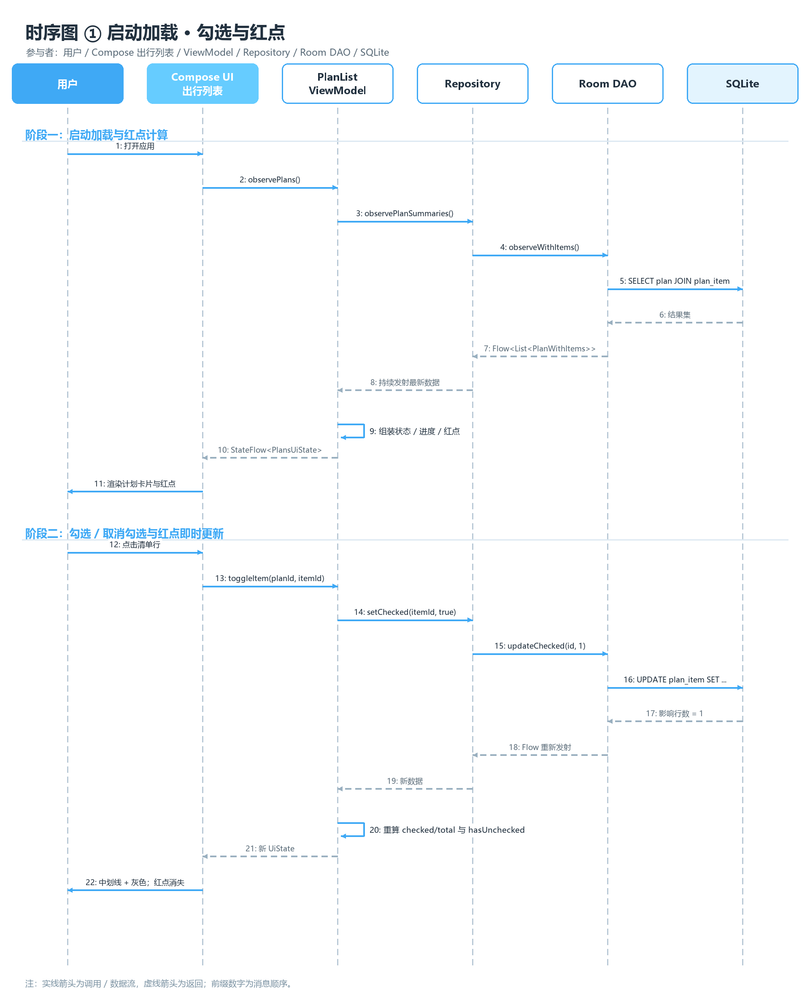
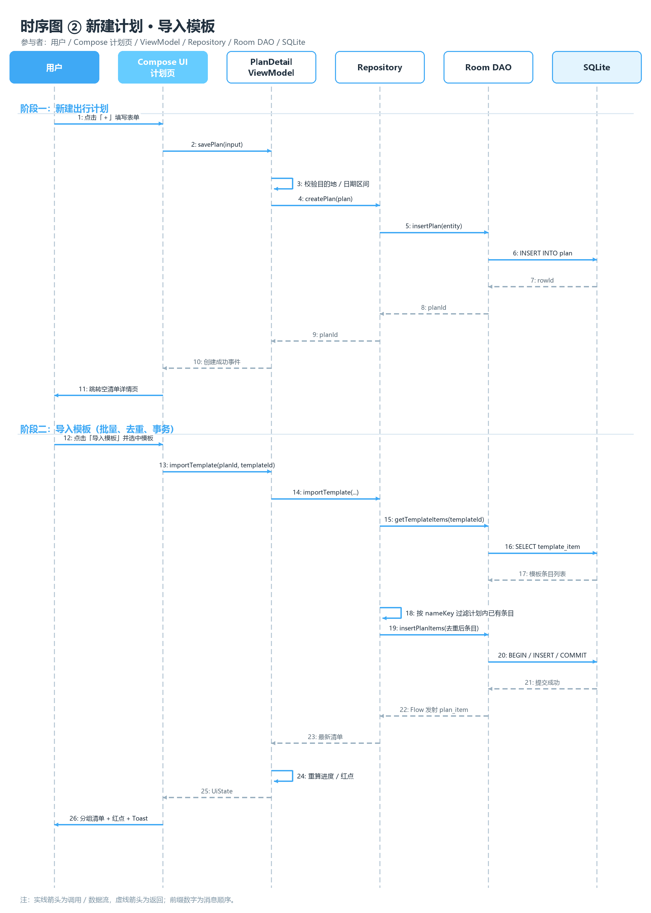
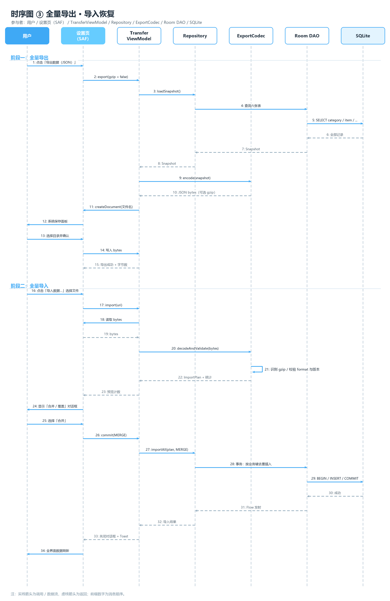

# 寸笺 · 时序图

三张时序图分别覆盖：

1. **启动加载 · 勾选与红点**：从冷启动到一次勾选动作的完整数据流；
2. **新建计划 · 导入模板**：计划落库 + 模板批量导入（去重、事务）；
3. **全量导出 · 导入恢复**：SAF、编解码、合并 / 覆盖事务。

> 图中实线为调用 / 数据流，虚线为返回；前缀数字为消息顺序，与下方表格一一对应。

---

## 1. 启动加载 · 勾选与红点

**参与者**：用户 / Compose UI（出行列表） / PlanListViewModel / Repository / Room DAO / SQLite

### 阶段一：启动加载与红点计算

| # | 发送方 → 接收方 | 消息 | 说明 |
| --- | --- | --- | --- |
| 1 | 用户 → Compose UI | 打开应用 | 冷启动 `MainActivity` |
| 2 | Compose UI → ViewModel | `observePlans()` | 页面进入组合，订阅 UiState |
| 3 | ViewModel → Repository | `observePlanSummaries()` | 请求带条目的计划列表 |
| 4 | Repository → Room DAO | `observeWithItems()` | `@Transaction` + `@Relation` 查询 |
| 5 | Room DAO → SQLite | `SELECT plan JOIN plan_item` | 一次查询拿全计划与条目 |
| 6 | SQLite → Room DAO | 结果集 | Cursor 映射为实体 |
| 7 | Room DAO → Repository | `Flow<List<PlanWithItems>>` | Room 生成失效监听 |
| 8 | Repository → ViewModel | 持续发射最新数据 | 后续任何写入都会重新发射 |
| 9 | ViewModel（自处理） | 组装状态 / 进度 / 红点 | `PlanStatus` + `checked/total` + `hasUnchecked` |
| 10 | ViewModel → Compose UI | `StateFlow<PlansUiState>` | `stateIn(WhileSubscribed(5s))` |
| 11 | Compose UI → 用户 | 渲染计划卡片与红点 | 状态筛选、排序、预览 |

### 阶段二：勾选 / 取消勾选与红点即时更新

| # | 发送方 → 接收方 | 消息 | 说明 |
| --- | --- | --- | --- |
| 12 | 用户 → Compose UI | 点击清单行 | 整行可点，触发 toggle |
| 13 | Compose UI → ViewModel | `toggleItem(planId, itemId)` | 事件上行 |
| 14 | ViewModel → Repository | `setChecked(itemId, true)` | 目标值由当前状态取反 |
| 15 | Repository → Room DAO | `updateChecked(id, 1)` | 只更新一列 |
| 16 | Room DAO → SQLite | `UPDATE plan_item SET ...` | `checked = 1` |
| 17 | SQLite → Room DAO | 影响行数 = 1 | 0 表示条目已被移除 |
| 18 | Room DAO → Repository | Flow 重新发射 | `plan_item` 失效触发 |
| 19 | Repository → ViewModel | 新数据 | 含全部条目 |
| 20 | ViewModel（自处理） | 重算 `checked/total` 与 `hasUnchecked` | 同时更新分组计数 |
| 21 | ViewModel → Compose UI | 新 UiState | 稳定性：只重组受影响行 |
| 22 | Compose UI → 用户 | 中划线 + 灰色切换；红点同步 | 勾选时红点可能消失，取消时重新出现；进度条同步更新 |

**关键点**

- 列表订阅使用 `@Transaction` + `@Relation`，避免 N+1；
- 勾选只更新一列，Room 失效粒度小，长清单也不整表重查；
- 红点、进度、分组计数全部由同一条条目列表派生，不存在“红点与进度不一致”；
- `checked` 使用 Boolean，Room 映射为 INTEGER 0/1。

---

## 2. 新建计划 · 导入模板

**参与者**：用户 / Compose UI（计划页） / PlanDetailViewModel / Repository / Room DAO / SQLite

### 阶段一：新建出行计划

| # | 发送方 → 接收方 | 消息 | 说明 |
| --- | --- | --- | --- |
| 1 | 用户 → Compose UI | 点击「＋」填写表单 | 目的地、名称、日期、备注、主题色 |
| 2 | Compose UI → ViewModel | `savePlan(input)` | 新建模式 `planId = null` |
| 3 | ViewModel（自处理） | 校验目的地 / 日期区间 | 目的地 1–40 字；返程 ≥ 出发 |
| 4 | ViewModel → Repository | `createPlan(plan)` | 领域模型 |
| 5 | Repository → Room DAO | `insertPlan(entity)` | 映射实体 |
| 6 | Room DAO → SQLite | `INSERT INTO plan` | 自增主键 |
| 7 | SQLite → Room DAO | `rowId` | 新计划 id |
| 8 | Room DAO → Repository | `planId` | 返回主键 |
| 9 | Repository → ViewModel | `planId` | 事务完成 |
| 10 | ViewModel → Compose UI | 创建成功事件 | 一次性事件通道 |
| 11 | Compose UI → 用户 | 跳转空清单详情页 | 引导添加物品 / 导入模板 |

### 阶段二：导入模板（批量、去重、事务）

| # | 发送方 → 接收方 | 消息 | 说明 |
| --- | --- | --- | --- |
| 12 | 用户 → Compose UI | 点击「导入模板」并选中模板 | 弹层内单选 |
| 13 | Compose UI → ViewModel | `importTemplate(planId, templateId)` | 携带目标计划 |
| 14 | ViewModel → Repository | `importTemplate(...)` | 业务编排 |
| 15 | Repository → Room DAO | `getTemplateItems(templateId)` | 读取模板条目 |
| 16 | Room DAO → SQLite | `SELECT template_item` | 按 `sortOrder` |
| 17 | SQLite → Room DAO | 模板条目列表 | 名称 + 分类快照 |
| 18 | Repository（自处理） | 按 `nameKey` 过滤计划内已有条目 | 去重，保留模板顺序 |
| 19 | Repository → Room DAO | `insertPlanItems(去重后条目)` | `@Insert` 列表 |
| 20 | Room DAO → SQLite | `BEGIN / INSERT / COMMIT` | `withTransaction` |
| 21 | SQLite → Room DAO | 提交成功 | 失败回滚 |
| 22 | Room DAO → Repository | Flow 发射 `plan_item` | 触发列表刷新 |
| 23 | Repository → ViewModel | 最新清单 | 与计划一起查询 |
| 24 | ViewModel（自处理） | 重算进度 / 红点 | 含新条目 |
| 25 | ViewModel → Compose UI | UiState | 分组展示 |
| 26 | Compose UI → 用户 | 分组清单 + 红点 + Toast | 「导入 7 件，跳过 5 件已有」 |

**关键点**

- 计划创建与模板导入是两个独立事务：先建计划，再导入，失败不会丢计划；
- 去重键为 `planId + nameKey`，`nameKey` 统一 `trim().lowercase(Locale.ROOT)`；
- 模板条目复制为**快照**（名称 + 分类名），此后模板或物品改名不回溯；
- 导入成功后更新模板 `lastUsedAt`，用于模板列表排序；
- 插入顺序沿用模板 `sortOrder`，保证分组内顺序稳定。

---

## 3. 全量导出 · 导入恢复

**参与者**：用户 / 设置页（SAF） / TransferViewModel / Repository / ExportCodec / Room DAO / SQLite

### 阶段一：全量导出

| # | 发送方 → 接收方 | 消息 | 说明 |
| --- | --- | --- | --- |
| 1 | 用户 → 设置页 | 点击「导出数据（JSON）」 | 也可选 gzip |
| 2 | 设置页 → TransferViewModel | `export(gzip = false)` | 记录用户选择 |
| 3 | TransferViewModel → Repository | `loadSnapshot()` | 读六张表 |
| 4 | Repository → Room DAO | 查询六张表 | 同一事务内读取，保证一致 |
| 5 | Room DAO → SQLite | `SELECT category / item / ...` | 按业务排序 |
| 6 | SQLite → Room DAO | 全部记录 | 分类 / 物品 / 模板 / 计划 / 条目 |
| 7 | Room DAO → Repository | `Snapshot` | DTO |
| 8 | Repository → TransferViewModel | `Snapshot` | — |
| 9 | TransferViewModel → ExportCodec | `encode(snapshot)` | 紧凑键 JSON |
| 10 | ExportCodec → TransferViewModel | JSON bytes（可选 gzip） | UTF-8；gzip 头 `1F 8B` |
| 11 | TransferViewModel → 设置页 | `createDocument(文件名)` | `ACTION_CREATE_DOCUMENT` |
| 12 | 设置页 → 用户 | 系统保存面板 | 用户选目录 / 改名 |
| 13 | 用户 → 设置页 | 选择目录并确认 | 返回 Uri |
| 14 | 设置页 → TransferViewModel | 写入 bytes | `ContentResolver.openOutputStream` |
| 15 | TransferViewModel → 设置页 | 导出成功 + 字节数 | Toast「已导出 5.2 KB」 |

### 阶段二：全量导入

| # | 发送方 → 接收方 | 消息 | 说明 |
| --- | --- | --- | --- |
| 16 | 用户 → 设置页 | 点击「导入数据…」选择文件 | `ACTION_OPEN_DOCUMENT` |
| 17 | 设置页 → TransferViewModel | `import(uri)` | 传入 Uri |
| 18 | TransferViewModel → 设置页 | 读取 bytes | 通过 ContentResolver |
| 19 | 设置页 → TransferViewModel | `bytes` | 上限 32 MB |
| 20 | TransferViewModel → ExportCodec | `decodeAndValidate(bytes)` | 识别 gzip + 解析 + 校验 |
| 21 | ExportCodec（自处理） | 识别 gzip / 校验 format 与版本 | `format = field-notes-export`，`version ≤ 1` |
| 22 | ExportCodec → TransferViewModel | `ImportPlan` + 统计 | 有效 / 重复 / 无效计数 |
| 23 | TransferViewModel → 设置页 | 预览计数 | 分类 / 物品 / 模板 / 计划 / 条目 |
| 24 | 设置页 → 用户 | 显示「合并 / 覆盖」对话框 | 覆盖附红色警告 |
| 25 | 用户 → 设置页 | 选择「合并」 | 或覆盖 / 取消 |
| 26 | 设置页 → TransferViewModel | `commit(MERGE)` | 模式枚举 |
| 27 | TransferViewModel → Repository | `importAll(plan, MERGE)` | 统一入口 |
| 28 | Repository → Room DAO | 事务：按业务键去重插入 | 分类→物品→模板→计划 |
| 29 | Room DAO → SQLite | `BEGIN / INSERT / COMMIT` | 失败整体回滚 |
| 30 | SQLite → Room DAO | 成功 | — |
| 31 | Room DAO → Repository | Flow 发射 | 所有表失效 |
| 32 | Repository → TransferViewModel | 导入结果 | 插入 / 跳过 / 忽略计数 |
| 33 | TransferViewModel → 设置页 | 关闭对话框 + Toast | 「导入 18 条，跳过 2 条重复」 |
| 34 | 设置页 → 用户 | 全界面数据刷新 | 四个页签自动更新 |

**关键点**

- 导出读取在一个事务内完成，避免读取过程中数据变化导致快照不一致；
- 导入先解析、后确认、再写库：解析阶段只读内存，不触碰数据库；
- 合并模式按业务键去重（分类名 / 物品名 / 模板名 / 计划四元组），覆盖模式先清空六张表；
- 全量导入在一个事务内完成，任何一步失败都回滚，绝不出现“导入一半”；
- 导入完成后不需要手动刷新，Room Flow 会驱动全部界面更新；
- 文件只经用户选择的 Uri 读写，不申请存储权限。
